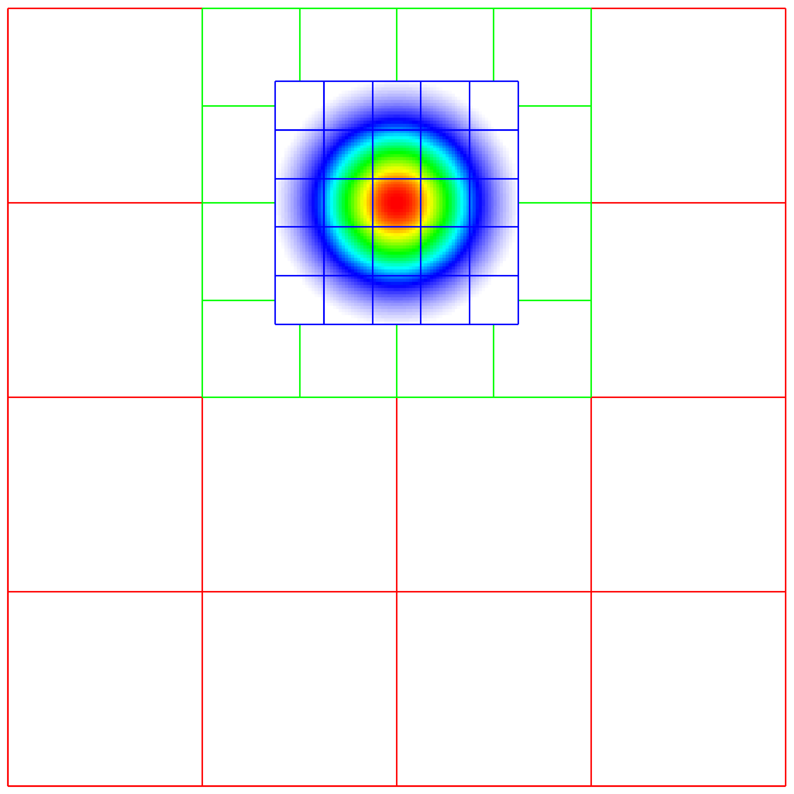
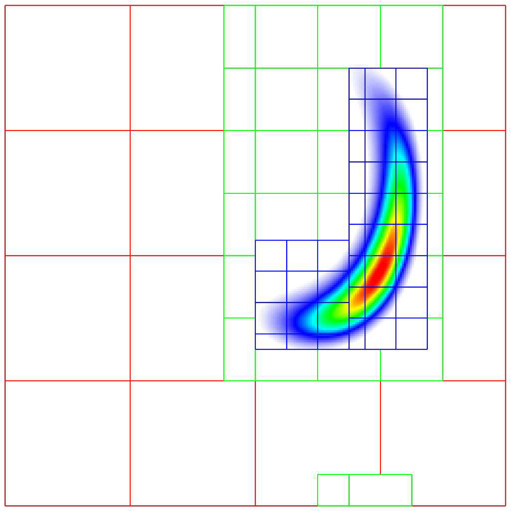
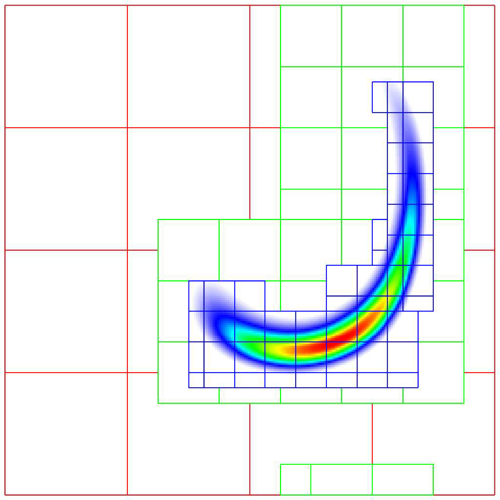
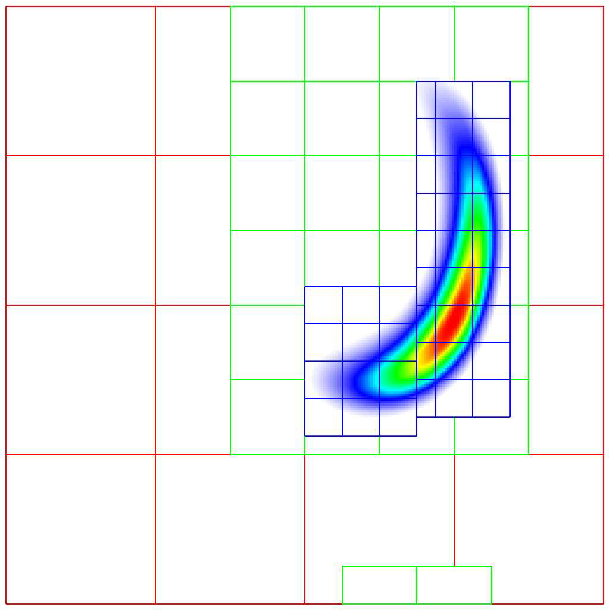
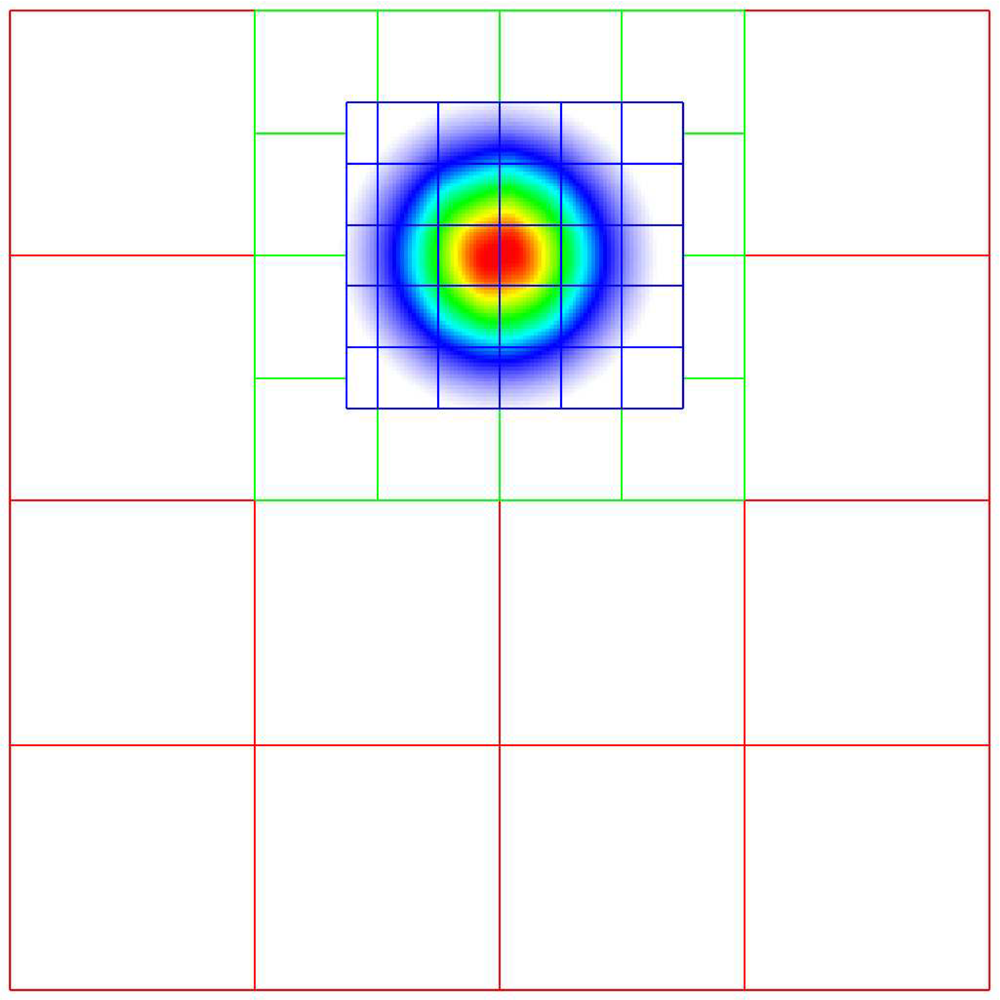
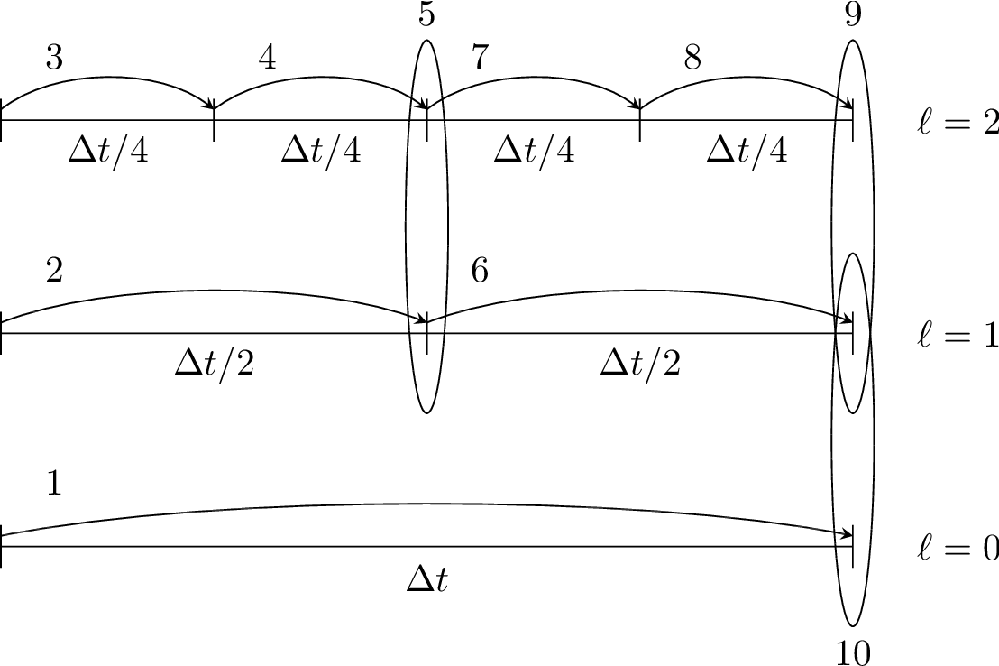

.. role:: cpp(code)
   :language: c++

.. role:: fortran(code)
   :language: fortran

.. raw:: latex

   \begin{center}

.. _fig:Adv:

.. table:: Time sequence (:math:`t=0, 0.5, 1, 1.5, 2` s) of advection of a Gaussian profile using the AdvectionAmrCore tutorial. The analytic velocity field distorts the profile, and then restores the profile to its original configuration. The red, green, and blue boxes indicate grids at AMR levels :math:`\ell=0,1`, and :math:`2`.
   :align: center

   +-----+-----+-----+-----+-----+
   | |a| | |b| | |c| | |d| | |e| |
   +-----+-----+-----+-----+-----+

.. raw:: latex

   \end{center}

.. _ss:amrcore:

AmrCore Source Code: Details
============================

Here we provide more information about the source code in ``amrex/Src/AmrCore``.

AmrMesh and AmrCore
-------------------

For single-level simulations
(see e.g., ``amrex-tutorials/Base/HeatEquation/main.cpp``)
the user needs to build :cpp:`Geometry`, :cpp:`DistributionMapping`,
and :cpp:`BoxArray` objects associated with the simulation. For simulations
with multiple levels of refinement, the :cpp:`AmrMesh` class can be thought
of as a container to store arrays of these objects (one for each level), and
information about the current grid structure.

``amrex/Src/AmrCore/AMReX_AmrMesh.cpp/H`` contains the :cpp:`AmrMesh` class.
The protected data members are:

.. highlight:: c++

::

    protected:
        int            verbose;
        int            max_level;       // Maximum allowed level.
        Vector<IntVect> ref_ratio;       // Refinement ratios [0:finest_level-1]

        int            finest_level;    // Current finest level.

        Vector<IntVect> n_error_buf;     // Buffer cells around each tagged cell.
        Vector<IntVect> blocking_factor; // Blocking factor in grid generation
                                        // (by level).
        Vector<IntVect> max_grid_size;   // Maximum allowable grid size (by level).
        Real           grid_eff;        // Grid efficiency.
        int            n_proper;        // # cells required for proper nesting.

        bool use_fixed_coarse_grids;
        int  use_fixed_upto_level;
        bool refine_grid_layout;        // chop up grids to have the number of
                                        // grids be no less than the number of procs

        Vector<Geometry>            geom;
        Vector<DistributionMapping> dmap;
        Vector<BoxArray>            grids;

The following parameters are frequently set via the inputs file or the command line.
Their usage is described in the section on :ref:`sec:grid_creation`.

.. raw:: latex

   \begin{center}

.. _tab:makevarimp:

.. table:: AmrCore parameters

   +-------------------------+-------+---------------------+
   | Variable                | Value | Default             |
   +=========================+=======+=====================+
   | amr.verbose             | int   | 0                   |
   +-------------------------+-------+---------------------+
   | amr.max_level           | int   | none                |
   +-------------------------+-------+---------------------+
   | amr.max_grid_size       | ints  | 32 in 3D, 128 in 2D |
   +-------------------------+-------+---------------------+
   | amr.n_proper            | int   | 1                   |
   +-------------------------+-------+---------------------+
   | amr.grid_eff            | Real  | 0.7                 |
   +-------------------------+-------+---------------------+
   | amr.n_error_buf         | int   | 1                   |
   +-------------------------+-------+---------------------+
   | amr.blocking_factor     | int   | 8                   |
   +-------------------------+-------+---------------------+
   | amr.refine_grid_layout  | int   | true                |
   +-------------------------+-------+---------------------+
   | amr.max_grid_iterations | int   | 4                   |
   +-------------------------+-------+---------------------+

.. raw:: latex

   \end{center}

AMReX_AmrCore.cpp/H contains the pure virtual class :cpp:`AmrCore`,
which is derived from the :cpp:`AmrMesh` class. AmrCore does not actually
have any data members, just additional member functions, some of which override
the base class AmrMesh.

There are no pure virtual functions in :cpp:`AmrMesh`, but
there are five pure virtual functions in the :cpp:`AmrCore` class. Any applications
you create must implement these functions. The tutorial code
``amrex-tutorials/AMR/AdvectionAmrCore`` provides a sample implementation in the derived
class :cpp:`AmrCoreAdv`.

.. highlight:: c++

::

    //! Tag cells for refinement.  TagBoxArray tags is built on level lev grids.
    virtual void ErrorEst (int lev, TagBoxArray& tags, Real time,
                           int ngrow) override = 0;

    //! Make a new level from scratch using provided BoxArray and DistributionMapping.
    //! Only used during initialization.
    virtual void MakeNewLevelFromScratch (int lev, Real time, const BoxArray& ba,
                                          const DistributionMapping& dm) override = 0;

    //! Make a new level using provided BoxArray and DistributionMapping and fill
    //  with interpolated coarse level data.
    virtual void MakeNewLevelFromCoarse (int lev, Real time, const BoxArray& ba,
                                         const DistributionMapping& dm) = 0;

    //! Remake an existing level using provided BoxArray and DistributionMapping
    //  and fill with existing fine and coarse data.
    virtual void RemakeLevel (int lev, Real time, const BoxArray& ba,
                              const DistributionMapping& dm) = 0;

    //! Delete level data
    virtual void ClearLevel (int lev) = 0;

Refer to the :cpp:`AmrCoreAdv` class in
``amrex-tutorials/AMR/AdvectionAmrCore``
for a sample implementation.

TagBox and Cluster
------------------

These classes are used in the grid generation process.
The :cpp:`TagBox` class is essentially a data structure that marks which
cells are "tagged" for refinement.
:cpp:`Cluster` (and :cpp:`ClusterList` contained within the same file) are classes
that help sort tagged cells and generate a grid structure that contains all
the tagged cells. These classes and their member functions are largely
hidden from any application codes through simple interfaces
such as :cpp:`regrid` and :cpp:`ErrorEst` (a routine for tagging cells for refinement).

.. _sec:amrcore:fillpatch:

FillPatchUtil and Interpolater
------------------------------

..
   For multi-level codes using the ``amrex/Src/AmrCore`` source code, the
   functions described above still work, however additional classes need to be set
   up since the :cpp:`FillPatch` routines call them.  In fact it is possible to
   avoid using the single-level calls directly if you fill all your grids and
   ghost cells using the :cpp:`FillPatch` routines.  Refer to
   ``amrex-tutorials/AMR/AdvectionAmrCore/`` for an example.  The class
   :cpp:`PhysBCFunct` in ``amrex/Src/Base/AMReX_PhysBCFunct.cpp``
   contains a :cpp:`Vector<BCRec>`, :cpp:`Geometry`, and a functor
   handling external Dirichlet boundaries, and provides an
   :cpp:`operator()` that fills domain boundaries for a :cpp:`MultiFab`.

Many codes, including the AdvectionAmrCore example, contain an array of MultiFabs
(one for each level of refinement), and then use FillPatch operations to fill temporary
MultiFabs that may include a different number of ghost cells. FillPatch operations fill
all cells, valid and ghost, using actual valid data at that level, space-time interpolated data
from the next-coarser level, neighboring grids at the same level, and domain
boundary conditions (for examples that have non-periodic boundary conditions).
Note that at the coarsest level,
interior cells and domain boundaries (which can be periodic or prescribed based on physical considerations)
need to be filled. At non-coarsest levels, the ghost cells can also be interior or on the domain boundary,
but they can also be at coarse-fine interfaces away from the domain boundary.
:cpp:`AMReX_FillPatchUtil.cpp/H` contains two primary functions of interest.

#. :cpp:`FillPatchSingleLevel()` fills a :cpp:`MultiFab` and its ghost region at a single level of
   refinement. The routine is flexible enough to interpolate in time between two MultiFabs
   associated with different times.

#. :cpp:`FillPatchTwoLevels()` fills a :cpp:`MultiFab` and its ghost region at a single level of
   refinement, assuming there is an underlying coarse level. This routine is flexible enough to interpolate
   the coarser level in time first using :cpp:`FillPatchSingleLevel()`.

Note that :cpp:`FillPatchSingleLevel()` and :cpp:`FillPatchTwoLevels()` call the
single-level routines :cpp:`MultiFab::FillBoundary` and :cpp:`FillDomainBoundary()`
to fill interior, periodic, and physical boundary ghost cells.  In principle, you can
write a single-level application that calls :cpp:`FillPatchSingleLevel()` instead
of using :cpp:`MultiFab::FillBoundary` and :cpp:`FillDomainBoundary()`.

The :cpp:`FillPatchUtil` routines use an :cpp:`Interpolator`. This is largely hidden from application codes.
AMReX_Interpolater.cpp/H contains the virtual base class :cpp:`Interpolater`, which provides
an interface for coarse-to-fine spatial interpolation operators. The fillpatch routines described
above require an :cpp:`Interpolater` for :cpp:`FillPatchTwoLevels()`.
Within AMReX_Interpolater.cpp/H, the derived classes are:

-  :cpp:`NodeBilinear`

-  :cpp:`CellBilinear`

-  :cpp:`CellConservativeLinear`

-  :cpp:`CellConservativeProtected`

-  :cpp:`CellConservativeQuartic`

-  :cpp:`CellQuadratic`

-  :cpp:`PCInterp`

-  :cpp:`FaceLinear`

-  :cpp:`FaceDivFree`: This is more accurately a divergence-preserving interpolation on face-centered data, i.e., it ensures the divergence of the fine ghost cells matches the value of the divergence of the underlying coarse cell. All fine cells overlying a given coarse cell will have the same divergence, even when the coarse grid divergence is spatially varying. Note that when using this with :cpp:`FillPatch` for time sub-cycling, the coarse grid times may not match the fine grid time, in which case :cpp:`FillPatch` will create coarse values at the fine time before calling this interpolation and the result of the :cpp:`FillPatch` is *not* guaranteed to preserve the original divergence.

These Interpolaters can be executed on CPU or GPU, with certain limitations:

-  :cpp:`CellConservativeProtected` only works in 2D and 3D.

-  :cpp:`CellQuadratic` does not support spherical coordinates in 2D.

-  :cpp:`CellConservativeQuartic` only works with a refinement ratio of 2.

-  :cpp:`FaceDivFree` only works in 2D and 3D, and the refinement ratio in
   each direction must be 2 or 4. On GPUs, a refinement ratio other than 2
   must be run on the device. In 2D RZ, only a refinement ratio of 2 is
   supported.

.. _sec:amrcore:fluxreg:

Using FluxRegisters
-------------------

AMReX_FluxRegister.cpp/H contains the class :cpp:`FluxRegister`, which is
derived from the class :cpp:`BndryRegister` (in ``amrex/Src/Boundary/AMReX_BndryRegister``).
In the most general terms, a FluxRegister is a special type of BndryRegister
that stores and manipulates data (most often fluxes) at coarse-fine interfaces.
A simple usage scenario comes from a conservative discretization of a hyperbolic
system:

.. math::

   \frac{\partial\phi}{\partial t} = \nabla\cdot{\bf F}
   \rightarrow
   \frac{\phi_{i,\,j}^{n+1}-\phi_{i,\,j}^n}{\Delta t} = \frac{F_{i+^1\!/_2,\,j}-F_{i-^1\!/_2,\,j}}{\Delta x} + \frac{F_{i,\,j+^1\!/_2} - F_{i,\,j-^1\!/_2}}{\Delta y}.

Consider a two-level, two-dimensional simulation. A standard methodology for
advancing the solution in time is to first advance the coarse grid solution
ignoring the fine level, and then advance the fine grid solution using the
coarse level only to supply boundary conditions. At the coarse-fine interface,
the area-weighted fluxes from the fine grid advance do not in general match the
underlying flux from the coarse grid face, resulting in a lack of global
conservation. Note that for subcycling-in-time algorithms (where for each coarse
grid advance, the fine grid is advanced :math:`r` times using a coarse grid time
step reduced by a factor of :math:`r`, where :math:`r` is the refinement ratio),
the coarse grid flux must be compared to the area *and* time-weighted fine grid
fluxes. A :cpp:`FluxRegister` accumulates and ultimately stores the net
difference in fluxes between the coarse grid and fine grid advance over each
face over a given coarse time step. The simplest possible synchronization step
is to modify the coarse grid solution in the coarse cells immediately adjacent to
the coarse-fine interface to account for the mismatch stored in the
FluxRegister. This can be done "simply" by taking the coarse-level divergence of
the data in the FluxRegister using the :cpp:`reflux` function.

The Fortran routines that perform the actual floating-point work associated with
incrementing data in a :cpp:`FluxRegister` are contained in the files
AMReX_FLUXREG_F.H and AMReX_FLUXREG_xD.F.

AmrParticles and AmrParGDB
--------------------------

The AmrCore/ directory contains derived classes for dealing with particles
in a multi-level framework. The description of the base classes
are given in the chapter on :ref:`Chap:Particles`.

AMReX_AmrParticles.cpp/H contains the classes :cpp:`AmrParticleContainer`
and :cpp:`AmrTracerParticleContainer`, which are derived from the classes
:cpp:`ParticleContainer` (in ``amrex/Src/Particle/AMReX_Particles``)
and :cpp:`TracerParticleContainer` (in ``amrex/Src/Particle/AMReX_TracerParticles``).

AMReX_AmrParGDB.cpp/H contains the class :cpp:`AmrParGDB`, which is derived from
the class :cpp:`ParGDBBase` (in ``amrex/Src/Particle/AMReX_ParGDB``).

Example: AdvectionAmrCore
=========================

The Advection Equation
----------------------

We seek to solve the advection equation on a multi-level, adaptive grid structure:

.. math:: \frac{\partial\phi}{\partial t} = -\nabla\cdot(\phi{\bf U}).

The velocity field is a specified divergence-free (so the flow field is incompressible)
function of space and time. The initial scalar field is a
Gaussian profile. To integrate these equations on a given level, we use a simple conservative update,

.. math:: \frac{\phi_{i,\,j}^{n+1}-\phi_{i,\,j}^n}{\Delta t} = -\frac{(\phi u)_{i+^1\!/_2,\,j}^{n+^1\!/_2}-(\phi u)_{i-^1\!/_2,\,j}^{n+^1\!/_2}}{\Delta x} - \frac{(\phi v)_{i,\,j+^1\!/_2}^{n+^1\!/_2} - (\phi v)_{i,\,j-^1\!/_2}^{n+^1\!/_2}}{\Delta y},

where the velocities on faces are prescribed functions of space and time, and the scalars on faces
are computed by upwinding with limited slopes. The fluxes in this case are the face-centered
":math:`\phi u`" and ":math:`\phi v`" terms. Each level is advanced with Heun's method
(a two-stage Runge-Kutta method), and the fluxes of the two stages are averaged, so that
they are time-centered.

We use a subcycling-in-time approach where finer levels are advanced with smaller
time steps than coarser levels, and then synchronization is later performed between levels.
More specifically, the multi-level procedure can most
easily be thought of as a recursive algorithm in which, to advance level :math:`\ell`,
:math:`0\le\ell\le\ell_{\rm max}`, the following steps are taken:

-  Advance level :math:`\ell` in time by one time step, :math:`\Delta t^{\ell}`, as if it is
   the only level. If :math:`\ell>0`, obtain boundary data (i.e. fill the level :math:`\ell` ghost cells)
   using space- and time-interpolated data from the grids at :math:`\ell-1` where appropriate.

-  If :math:`\ell<\ell_{\rm max}`

   -  Advance level :math:`(\ell+1)` for :math:`r` time steps with :math:`\Delta t^{\ell+1} = \frac{1}{r}\Delta t^{\ell}`.

   -  Synchronize the data between levels :math:`\ell` and :math:`\ell+1`.

.. raw:: latex

   \begin{center}

.. _fig:subcycling:

   Schematic of subcycling-in-time algorithm.

.. raw:: latex

   \end{center}

Specifically, for a 3-level simulation, as depicted in :ref:`fig:subcycling`:

#. Integrate :math:`\ell=0` over :math:`\Delta t`.

#. Integrate :math:`\ell=1` over :math:`\Delta t/2`.

#. Integrate :math:`\ell=2` over :math:`\Delta t/4`.

#. Integrate :math:`\ell=2` over :math:`\Delta t/4`.

#. Synchronize levels :math:`\ell=1,2`.

#. Integrate :math:`\ell=1` over :math:`\Delta t/2`.

#. Integrate :math:`\ell=2` over :math:`\Delta t/4`.

#. Integrate :math:`\ell=2` over :math:`\Delta t/4`.

#. Synchronize levels :math:`\ell=1,2`.

#. Synchronize levels :math:`\ell=0,1`.

For the scalar field, we keep track of volume and time-weighted fluxes at coarse-fine interfaces.
We accumulate area and time-weighted fluxes in :cpp:`FluxRegister` objects, which can be
thought of as special boundary FABsets associated with coarse-fine interfaces.
Since the fluxes are area and time-weighted (and sign-weighted, depending on whether they
come from the coarse or fine level), the flux registers essentially store the extent by
which the solution does not maintain conservation. Conservation only happens if the
sum of the (area and time-weighted) fine fluxes equals the coarse flux, which in general
is not true.

The idea behind the level :math:`\ell/(\ell+1)` synchronization step is to correct for sources of
mismatch in the composite solution:

#. The data at level :math:`\ell` that underlie the level :math:`\ell+1` data are not synchronized with the level :math:`\ell+1` data.
   This is simply corrected by overwriting covered coarse cells to be the average of the overlying fine cells.

#. The area and time-weighted fluxes from the level :math:`\ell` faces and the level :math:`\ell+1` faces
   do not agree at the :math:`\ell/(\ell+1)` interface, resulting in a loss of conservation.
   The remedy is to modify the solution in the coarse cells immediately next to the coarse-fine interface
   to account for the mismatch stored in the flux register (computed by taking the coarse-level divergence of the
   flux register data).

Code Structure
--------------

The source code of the example is in ``amrex-tutorials/AMR/AdvectionAmrCore``.

-  ``main.cpp`` sets defaults for the parameters :cpp:`AmrCore` requires, runs the
   simulation, and checks that the total mass is conserved.

-  ``AmrCoreAdv.H`` and ``AmrCoreAdv.cpp`` contain the :cpp:`AmrCoreAdv` class, which is
   derived from :cpp:`AmrCore`: the level data, the :cpp:`AmrCore` callbacks,
   :cpp:`FillPatch`, and the time stepping.

-  ``Advance.cpp`` advances a single level, computes the fluxes and estimates the time step.

-  ``IO.cpp`` writes plotfiles and checkpoints, and reads a checkpoint for restart.

-  ``Kernels.H`` contains the initial data, the velocity field and the upwind flux.

The code is built with the ``GNUmakefile`` or ``CMakeLists.txt`` in that directory and
run with the ``inputs`` file there.

Here is a high-level pseudo-code of the flow of the program:

.. highlight:: c++

::

    /* AdvectionAmrCore Pseudocode */
    main()
      AmrCoreAdv amr_core_adv; // build an AmrCoreAdv object
      amr_core_adv.InitData()  // initialize data on all levels
        AmrCore::InitFromScratch()
          AmrMesh::MakeNewGrids()
            AmrMesh::MakeBaseGrids() // define level 0 grids
            AmrCoreAdv::MakeNewLevelFromScratch()
              /* allocate phi_old, phi_new and flux registers, fill phi */
            if (max_level > 0) {
              do {
                AmrMesh::MakeNewGrids()
                  /* construct next finer grid based on tagging criteria */
                AmrCoreAdv::MakeNewLevelFromScratch()
                  /* allocate phi_old, phi_new and flux registers, fill phi */
              } while (finest_level < max_level);
            }
      amr_core_adv.Evolve()
        loop over coarse time steps {
          ComputeDt()
          TimeStepWithSubcycling(lev=0) // advance a level
            /* check regrid conditions and regrid if necessary */
            AdvanceLevel()
              /* copy phi into a MultiFab and fill ghost cells */
              /* advance phi */
              /* update flux registers */
            if (lev < finest_level) {
              TimeStepWithSubcycling(lev+1) // recursive call to advance the next-finer level "r" times
                /* check regrid conditions and regrid if necessary */
                AdvanceLevel()
                  /* copy phi into a MultiFab and fill ghost cells */
                  /* advance phi */
                  /* update flux registers */
              Reflux()        // synchronize lev and lev+1 using FluxRegister divergence
              AverageDownTo() // set covered coarse cells to be the average of fine
            }
          /* write plotfile and checkpoint */
        }

The AmrCoreAdv Class
--------------------

This example uses the class :cpp:`AmrCoreAdv`, which is derived from the class :cpp:`AmrCore`
(which is derived from :cpp:`AmrMesh`). It is declared in ``AmrCoreAdv.H``, and its
member functions are implemented in the source files listed in the Code Structure
section above.

FluxRegisters
-------------

The function :cpp:`AmrCoreAdv::AdvanceLevel()` computes the fluxes on all faces of a
level (in :cpp:`AmrCoreAdv::ComputeFluxes()`) and uses them to update the state.
The same fluxes are then used to set or increment the flux registers. Note that the
flux register ``flux_reg[lev]`` is associated with the interface between levels
``lev`` and ``lev-1``.

.. highlight:: c++

::

    if (do_reflux) {
        // The registers hold flux * area * dt. The coarse level of an
        // interface subtracts its flux, and the fine level adds its fluxes.
        for (int idim = 0; idim < AMREX_SPACEDIM; ++idim) {
            Real area = 1.0_rt;
            for (int d = 0; d < AMREX_SPACEDIM; ++d) {
                if (d != idim) { area *= geom[lev].CellSize(d); }
            }
            if (lev < finest_level) {
                flux_reg[lev+1]->CrseInit(flux[idim], idim, 0, 0, 1, -dt_lev*area);
            }
            if (lev > 0) {
                flux_reg[lev]->FineAdd(flux[idim], idim, 0, 0, 1, dt_lev*area);
            }
        }
    }

The synchronization is performed at the end of :cpp:`AmrCoreAdv::TimeStepWithSubcycling`:

.. highlight:: c++

::

    if (do_reflux) {
        // Replace the coarse flux with the time and area averaged fine flux
        // on the coarse/fine boundary.
        flux_reg[lev+1]->Reflux(phi_new[lev], 1.0_rt, 0, 0, 1, geom[lev]);
    }

    AverageDownTo(lev); // average lev+1 down to lev

.. _ss:regridding:

Regridding
----------

The regrid function belongs to the :cpp:`AmrCore` class (it is virtual -- in this
tutorial we use the implementation in :cpp:`AmrCore`).

At the beginning of each time step, we check whether we need to regrid.
In this example, we use :cpp:`regrid_int` and keep track of how many times each level
has been advanced. When any given level :math:`\ell<\ell_{\rm max}` has been
advanced a number of times equal to a multiple of :cpp:`regrid_int`, we call the :cpp:`regrid` function.

.. highlight:: c++

::

    void
    AmrCoreAdv::TimeStepWithSubcycling (int lev, Real time)
    {
        // Regrid levels finer than lev every regrid_int steps of lev, unless a
        // coarser level has just done it.
        if (regrid_int > 0 && lev < max_level && istep[lev] > last_regrid_step[lev]
            && istep[lev] % regrid_int == 0)
        {
            // regrid could add newly refined levels
            // (if finest_level < max_level)
            // so we save the previous finest level index
            int const old_finest = finest_level;
            regrid(lev, time);
            for (int k = lev; k <= finest_level; ++k) {
                last_regrid_step[k] = istep[k];
            }
            // if there are newly created levels, set the time step
            for (int k = old_finest+1; k <= finest_level; ++k) {
                dt[k] = dt[k-1] / nsubsteps[k];
            }
        }
        ...
    }

Central to the regridding process is the concept of "tagging" cells that need refinement.
:cpp:`ErrorEst` is a pure virtual function of :cpp:`AmrCore`, so each application code must
contain an implementation. In this example, the refinement criterion is an
:cpp:`AMRErrorTag` built from the ``adv.phierr`` runtime parameter, a list of
thresholds starting at level 0; levels beyond the end of the list use its last value.
A cell is tagged where :math:`\phi` is greater than the threshold of its level.
:cpp:`ErrorEst` applies it to the :cpp:`TagBoxArray`:

.. highlight:: c++

::

    void
    AmrCoreAdv::ErrorEst (int lev, TagBoxArray& tags, Real time, int /*ngrow*/)
    {
        for (auto const& tag : error_tags) {
            tag(tags, &phi_new[lev], TagBox::CLEAR, TagBox::SET, time, lev, Geom(lev));
        }
    }

An application can also tag cells directly in :cpp:`ErrorEst`, for example with a
:cpp:`ParallelFor` over the :cpp:`TagBoxArray`, to implement more elaborate criteria such as
gradients or logical expressions.

.. _ss:fillpatch:

FillPatch
---------

This example has two functions, :cpp:`AmrCoreAdv::FillPatch` and :cpp:`AmrCoreAdv::FillCoarsePatch`,
that make use of functions in AmrCore/AMReX_FillPatchUtil.

In :cpp:`AmrCoreAdv::AdvanceLevel`, we create a temporary :cpp:`MultiFab` called :cpp:`Sborder`, which
is essentially :math:`\phi` but with ghost cells filled in. The valid and ghost cells are filled in from
actual valid data at that level, space-time interpolated data from the next-coarser level,
neighboring grids at the same level, or domain boundary conditions
(for examples that have non-periodic boundary conditions).

.. highlight:: c++

::

    MultiFab Sborder(grids[lev], dmap[lev], 1, 2);
    FillPatch(lev, stage_time, Sborder);

Several other calls to fillpatch routines are hidden from the user in the regridding process.
